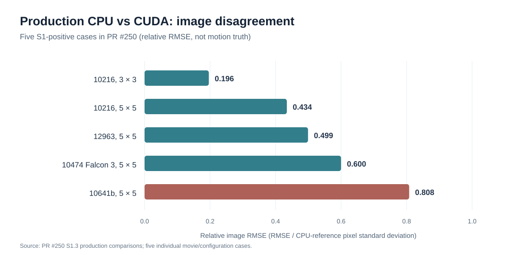
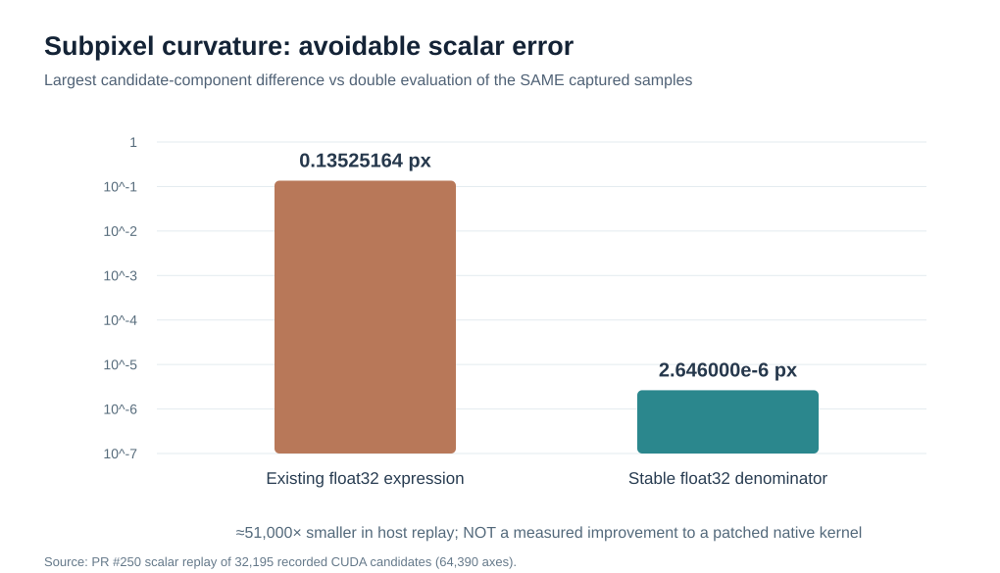
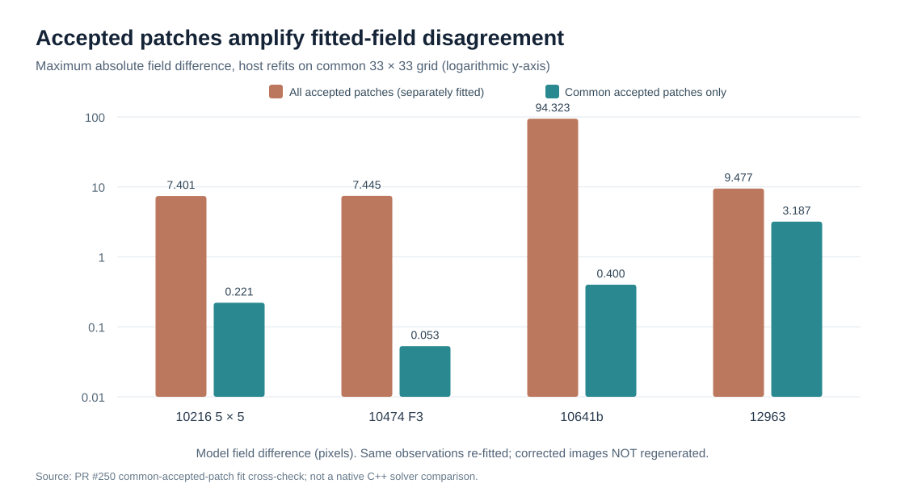

# MotionCorr Standalone: CPU/CUDA divergence and numerical correctness audit

**Review date:** 20 October 2026  
**Status:** Independent, documentation-only synthesis. No production source or numerical gate changes.  
**Code under review:** frozen release-candidate source [6d68e2d6](https://github.com/KingAlejandro/MotionCorr-standalone/tree/6d68e2d6). The relevant production source is unchanged on [main 36913740](https://github.com/KingAlejandro/MotionCorr-standalone/commit/3691374061f782bc84531fd1c79d017ddcb5a7c2) and the [PR #250 evidence head 7fc9733f](https://github.com/KingAlejandro/MotionCorr-standalone/commit/7fc9733f3b02cd34f7dd3dde7e8a89e7ed7ff1bf).

**Relevant tracking:** [S1 campaign #238](https://github.com/KingAlejandro/MotionCorr-standalone/issues/238), [S1.3 / S1.3b evidence PR #250](https://github.com/KingAlejandro/MotionCorr-standalone/pull/250), [numerical exploration #232](https://github.com/KingAlejandro/MotionCorr-standalone/issues/232), [peak ties #70](https://github.com/KingAlejandro/MotionCorr-standalone/issues/70).

> **Scope and scientific caveat.** This review checks source paths, historical provenance and retained native captures, and distinguishes native tests from their host-side replays and fit-only counterfactuals. It does **not** claim that proposed kernels were compiled and run, that all final-image differences have been causally assigned, or that agreement with the CPU proves scientific accuracy. The retained S1.3 campaign uses production-equivalent Release builds on the 4GPUs A100 venue, and its instrumentation-neutrality controls passed; this report adds no new GPU measurements. The existing release and scientific gates remain unchanged.

## Executive assessment

The CPU/CUDA discrepancy is **not just expected FFTW/cuFFT or float32/double rounding**. Small upstream numerical differences are magnified by nearly tied correlation peaks, an iterative estimator, patch convergence/acceptance and a polynomial fit. In addition, two avoidable, independently demonstrated implementation problems merit priority:

1. **A real inverse FFT can consume non-Hermitian half-spectra.** Fractional Fourier shifts break boundary conjugacy; both the global-to-patch reconstruction and the separate dose-weighted reconstruction use these spectra. CUDA C2R requires valid Hermitian input. Reduced-grid correlation crops have an additional symmetry hazard. The input-contract problem is confirmed; its fractional contribution to the complete S1 image mismatch still needs native ablation.
2. **CUDA's subpixel curvature denominator suffers catastrophic cancellation even for identical captured CCF samples.** The existing expression reproduces native candidates. A difference-based float32 expression almost eliminates this *same-input scalar* discrepancy in retained host replay. It is not yet a native fixed-kernel or end-to-end result.

Other definite correctness problems include a model distortion guard evaluated on the wrong coordinate domain, a boundary interpolation branch-sensitive to float rounding, a transformed EER gain changing numerical interpretation, insufficient polynomial coefficient serialization precision and unconstrained subpixel extrapolation at a correlation-window boundary. Exact-tie ordering is a separate, already tracked GPU parity issue. None should be silently treated as a new cause of every S1 result.

### Pipeline and first possible failure points

~~~mermaid
flowchart TD
    A["0–3 · Decode / detector / gain"] --> B["4–6 · Frame FFT and preprocessing"]
    B --> C["7a–b · Global leave-one-out CCF"]
    C --> D["7c · Integer peak + subpixel fit"]
    D --> E["7d · Update global Fourier phase"]
    E --> F["8 · Global C2R reconstruction"]
    F --> G["9 · Crop patches / group frames"]
    G --> H["10 · Local CCF + peak + convergence"]
    H --> I["11–13 · Select patches / fit polynomial"]
    E --> J["14 · Separate dose-weighted C2R"]
    I --> K["15–17 · Local warp / weighted sum"]
    J --> K
    K --> L["18 · MRC + STAR outputs"]
    X["Input interpretation error"] -.-> A
    P["Tie / peak arithmetic"] -.-> D
    Q["C2R representation invariant"] -.-> F
    Q -.-> J
    Q -.-> H
    R["Guard / fit amplification"] -.-> I
    S["Interpolation edge case"] -.-> K
    T["STAR precision loss"] -.-> L
~~~

*Numbering follows the project's stage-by-stage processing explanation. The global FFT branch is reused for final dose-weighted reconstruction; fixing just one C2R consumer is insufficient.*

## A. What the native S1 evidence actually shows

The chart uses the five production CPU/CUDA comparisons retained by [PR #250's evidence README](https://github.com/KingAlejandro/MotionCorr-standalone/blob/7fc9733f/docs/post_rc0/s1/ccf_ties/README.md): 10216 3×3 = 0.196182; 10216 5×5 = 0.434362; 12963 5×5 = 0.499014; 10474 Falcon 3 5×5 = 0.599858; 10641b 5×5 = 0.807827. Relative image RMSE means RMSE normalized by the reference image's population standard deviation. It is **not** a reconstruction-quality or FSC metric.

**Where trajectories bifurcate.** All **9/9 S1-relevant patches** first separate by selecting **different integer CCF peaks**. In 7/9 the competing candidate peaks are within 16 float32 ULPs on both maps; in 2/9 one backend has an exact or at-most-3-ULP tie while the other gives a 36–68-ULP lead. This is a precisely observed nonlinear amplification point, **not** proof that the first upstream error occurred in the integer selector. See [decisive-event records and neutrality controls](https://github.com/KingAlejandro/MotionCorr-standalone/blob/7fc9733f/docs/post_rc0/s1/ccf_ties/README.md).

The 10216 3×3 case is particularly instructive: all nine patches are accepted by both backends, yet one reference-frame near tie yields a ~1.79 px candidate jump, moves the whole relative trajectory and gives relative image RMSE 0.196. Thus acceptance-set differences are a *major* amplifier in several 5×5 cases but are not a universal prerequisite.

Additional exclusions: the fixed CPU-reference trajectory reduces 10216 5×5 relative RMSE to ~0.021, but leaves 12963 around 0.4999 with the near-tied patch events present. Captured CUDA retries reproduce their first-attempt peak choices; retry logic is not the identified source of these events. CPU's first-maximum search order and CUDA's equal-value reduction differ, but [#70's exact-tie mechanism](https://github.com/KingAlejandro/MotionCorr-standalone/issues/70) does not explain the nine S1-relevant first divergences.

### Causal interpretation, not a single-root-cause claim

~~~mermaid
flowchart LR
    A["Routine small FFT / reduction / phase differences"] --> C["Small CCF shape differences"]
    B["Non-Hermitian C2R inputs / backend-dependent real frames"] --> C
    C --> D{"Near-tied integer peaks"}
    D --> E["Different selected shift"]
    E --> F["Iterative reference / reference-frame anchoring"]
    F --> G["Patch convergence and acceptance"]
    G --> H["18-term local polynomial fit"]
    H --> I["Final corrected images"]
    J["CUDA subpixel curvature cancellation"] --> E
    K["Warp / dose reconstruction differences"] --> I
~~~

This diagram distinguishes **sources of variation** (left), **nonlinear amplifiers** (middle) and **final consequences** (right). A difference in the chosen peak is not itself evidence that cuFFT is wrong or that one trajectory is scientifically better.

## B. Global and local subpixel peak fitting: a demonstrated avoidable arithmetic error

**Affected steps:** global 7c, local 10. **Origin:** CUDA port. **Confidence:** confirmed same-input scalar difference with retained native captures; complete scientific impact unmeasured.

The separate-parabola fit uses a peak value m and two neighbors v+ and v-:

\[
\delta = -\frac{1}{2}\frac{v_+-v_-}{v_++v_--2m}.
\]

The [CPU fit](https://github.com/KingAlejandro/MotionCorr-standalone/blob/6d68e2d6/src/motioncorr_runner.cpp#L4776-L4818) uses RFLOAT (double by default) after reading float CCF samples. The [CUDA fit](https://github.com/KingAlejandro/MotionCorr-standalone/blob/6d68e2d6/src/acc/cuda/cuda_alignpatch.cu#L248-L260) forms the denominator in float; the addition of two large neighbours is rounded *before* subtracting twice the peak.

**Identical-sample witness, EMPIAR-10216, global iteration 1, frame 56:** m = 36366.4296875; v+ = 36365.69140625; v- = 36366.359375. The float expression obtains curvature denominator -0.8125 versus -0.80859375 with promoted evaluation. Native CUDA reports -1.644230723 px and native CPU -1.652173913 px, a **0.00794319 px** difference even though the integer peak and all five float32 CCF samples are identical.

The replay of **32,195 native CUDA frame-iteration records**, corresponding to 64,390 fitted axes, reproduces current native candidates. Replacing only the denominator with \((v_+-m)+(v_--m)\), holding the winner, float scale, guard and input samples fixed, reduces the *largest* difference from promoted same-sample evaluation from **0.13525164 px to 0.000002646 px**. These are host scalar counterfactuals, not benchmarked GPU fixes. [Recorded review and independent scalar check](https://github.com/KingAlejandro/MotionCorr-standalone/pull/250#pullrequestreview-5573028636).

**Candidate repair:** compare the difference-based float evaluation against promoting only the selected samples and fit to double. Test the real Release compiler, contraction/reassociation behavior, one-ULP plateaus, search-boundary samples, subnormals, non-finite values and the existing \(10^{-15}\) denominator guard. Guard behavior **can change** for flat/near-flat peaks: preserving it for the captured set is not proof of universal equivalence. Avoid inferring that this scalar change will remove integer-peak changes driven by different maps, or recover contrast already quantized in the CCF.

**Related conditioning concern:** both backends retain the DC pedestal in leave-one-out correlations. A uniform offset leaves the peak and curvature unchanged in real arithmetic, but not necessarily in float arithmetic after the map was quantized. A diagnostic that zeros *only the CCF spectrum's DC term before C2R* would separate pedestal-related precision loss from genuine correlation shape. Subtracting the mean after float C2R does not restore lost precision. This is an experiment proposal, **not an established S1 cure**.

## C. Fourier phase shifting and C2R: real-image input-contract violation

**Affected steps:** 7d→8 (patch-input reconstruction), 7b/10 (reduced correlation inverse), and 14 (dose-weighted output inverse). **Origin:** CPU behavior inherited from the RELION reference; CUDA adds a backend for which Hermitian input is an explicit documented requirement. **Confidence:** confirmed invalid input representation; contribution to S1 measured incompletely.

For a real image, the R2C half-spectrum must preserve conjugacy on \(k_x=0\), and on \(k_x=N_x/2\) if \(N_x\) is even:

\[
F(k_y,b) = \overline{F((-k_y)\bmod N_y,b)}.
\]

Fractional application of \(\exp(2\pi i(k_x\Delta x/N_x+k_y\Delta y/N_y))\) to these *stored boundary coefficients* need not preserve this condition. At a self-conjugate Nyquist mode, a quarter-pixel shift produces a nonzero imaginary part even in exact arithmetic. The source multiplies all included coefficients without restoring the required boundary relation. [CPU shift](https://github.com/KingAlejandro/MotionCorr-standalone/blob/6d68e2d6/src/motioncorr_runner.cpp#L5021-L5075) · [CUDA shift kernel](https://github.com/KingAlejandro/MotionCorr-standalone/blob/6d68e2d6/src/acc/cuda/cuda_alignpatch.cu#L264-L288).

The [cuFFT C2R documentation](https://docs.nvidia.com/cuda/archive/12.8.1/cufft/index.html#fourier-transform-types) requires Hermitian input for multidimensional C2R. Undefined behavior on invalid input is **an application contract breach, not a demonstrated cuFFT library bug**. FFTW's apparent tolerance of an invalid buffer is not an alternate scientific specification.

**Native evidence and a necessary correction to earlier attribution:** In S1.3b the whole-spectrum difference after equal nominal global shifts is at most about \(1.93\times10^{-6}\) relative in the checked frames, while the reconstructed full real frames differ at order \(7\times10^{-4}\)–\(10^{-2}\) relative. A row-dependent term accounts very accurately for the *cropped low-frequency patch-window* residual; its predictor reaches \(\leq 5.8\times10^{-7}\) in the 150 checked patch-frames. **It does not explain the entire full-band frame error.** After the best row-mean subtraction, frame 11 retains approximately \(1.07\times10^{-4}\) relative residual on 10216 and \(3.01\times10^{-4}\) on 12963. An additional alternating-x component is a hypothesis, not an identified cuFFT implementation mechanism. [S1.3b evidence](https://github.com/KingAlejandro/MotionCorr-standalone/blob/7fc9733f/docs/post_rc0/s1/ccf_ties/README.md) · [full-band review correction](https://github.com/KingAlejandro/MotionCorr-standalone/pull/250#pullrequestreview-5573621228).

**Both consumers matter.** [computeGlobalInverseFFT](https://github.com/KingAlejandro/MotionCorr-standalone/blob/6d68e2d6/src/acc/cuda/cuda_movie_session.cu#L2096-L2121) copies resident spectra into a scratch tile and performs C2R to supply locally cropped patches. The [dose-weighted output path](https://github.com/KingAlejandro/MotionCorr-standalone/blob/6d68e2d6/src/acc/cuda/cuda_realspace_dw.cu#L366-L405) later reads the *original resident spectra* into a separate weighted inverse buffer. Repairing only the first scratch is insufficient.

**Reduced CCF geometry is an additional source-level contract risk.** [CUDA computeReferenceKernel/computeCCFKernel](https://github.com/KingAlejandro/MotionCorr-standalone/blob/6d68e2d6/src/acc/cuda/cuda_alignpatch.cu#L130-L179) and the [CPU frequency crop](https://github.com/KingAlejandro/MotionCorr-standalone/blob/6d68e2d6/src/motioncorr_runner.cpp#L4761-L4772) copy an original frequency window into a smaller inverse grid. Original interior frequencies can become *new* self-conjugate Nyquist coefficients with missing conjugate partners. Suppressed boundary weights reduce their numerical importance but do not prove the invariant or eliminate the representation defect. **No additional S1 contribution from this cropped-grid issue has been measured.**

**Candidate diagnostic repair:** project each *actual inverse-consumption* buffer onto valid conjugate boundary pairs. For boundary column b,

\[
H(y,b)=\frac{F(y,b)+\overline{F((-y)\bmod N_y,b)}}{2}.
\]

Enforce real values at self-paired rows, preserve interior coefficients and do not zero entire Nyquist columns. Each pair needs a race-free implementation. Do not overwrite resident spectra or project them repeatedly after every increment without testing the resulting operator. Merely projecting the reduced CCF target also cannot reconstruct frequency partners omitted during cropping: folding/scaling at the new cutoffs needs an explicit policy.

**Scientific choice still open:** Hermitian projection defines a valid real image but does not uniquely define fractional shifting of Nyquist content. For an even-by-even checkerboard corner, projecting the joint phase gives \(\cos(\pi(\Delta x+\Delta y))\), whereas a separable real-Nyquist convention gives \(\cos(\pi\Delta x)\cos(\pi\Delta y)\). Validate a selected convention against an explicit real-valued reference, isolated modes, integer/fractional shifts and even/odd geometries before making it production behavior.

## D. Correlation-window boundary: subpixel extrapolation beyond the search

**Affected steps:** global 7c / local 10. **Origin:** inherited. **Confidence:** a native-captured case exists; downstream significance not yet isolated.

The [CPU window search and fit](https://github.com/KingAlejandro/MotionCorr-standalone/blob/6d68e2d6/src/motioncorr_runner.cpp#L4776-L4818) picks the best *integer* candidate inside a search interval, then reads samples immediately outside that interval when the peak is on its boundary. It checks only denominator magnitude, not whether the neighbourhood brackets a local maximum, whether the quadratic vertex lies nearby, or whether the final estimate remains inside the intended search bound.

A retained 12963 CPU patch (2,5), iteration 2, frame 32, has search window \([-13,13]\) CCF pixels, selects x = -13 while the -14 neighbour is higher, extrapolates to -14.08 and reports about **-53.32148 pixels** after scaling, exceeding the nominal 50-pixel range. The patch is subsequently accepted. This is not a memory-safety finding. It is an estimator validity gap. The patch's first CPU/CUDA separation was an earlier near-tie; this event is a later potential amplifier, not its proven initiating cause. [Native capture](https://github.com/KingAlejandro/MotionCorr-standalone/blob/7fc9733f/docs/post_rc0/s1/ccf_ties/raw/runs/e12963-p5-diag-cpu-on/ccf.txt.gz).

**Repair:** give boundary maxima an explicit fallback, bound the fractional correction and test concave/convex/unbracketed neighbours. Rejecting, using the integer peak or expanding the search have different scientific consequences and should be tested independently.

## E. Polynomial fit: acceptance-set amplification is real; solver failure is not established

**Affected steps:** 11–13. **Origin:** polynomial estimator inherited; input changes and acceptance decisions expose its sensitivity. **Confidence:** fit-only counterfactuals, not regenerated images.

The [fit constructs an 18-column design per shift component](https://github.com/KingAlejandro/MotionCorr-standalone/blob/6d68e2d6/src/motioncorr_runner.cpp#L3830-L3903) and estimates a spatially quadratic, temporally cubic local field. Different peak observations or a different accepted-patch subset can produce very different extrapolated fields, even when each least-squares calculation is numerically sound.

The figure shows *maximum absolute field difference in pixels* when both CPU and CUDA models are freshly refitted either to their full accepted sets or only to their intersection. The common-set control reduces 10641b from **94.323 to 0.400 px**, 10216 5×5 from **7.401 to 0.221 px**, 10474 Falcon 3 from **7.445 to 0.053 px**, but 12963 only from **9.477 to 3.187 px**. All fit designs examined were full rank; scaled and unscaled float64 refits agreed to below about \(3\times10^{-10}\) px. This is not evidence of a broken linear solver, and the 94-pixel number is an extrapolated field difference, not an observed CCF-peak error. [Fit-level review](https://github.com/KingAlejandro/MotionCorr-standalone/pull/250#pullrequestreview-5573092421).

Before introducing robust fitting or patch-confidence weighting, remove known upstream avoidable differences and measure how much fit divergence remains. Those alternatives change the scientific estimator and should not be silently bundled into a parity patch.

### An independent validation bug: incorrect model-guard coordinates

The [polynomial distortion guard](https://github.com/KingAlejandro/MotionCorr-standalone/blob/6d68e2d6/src/motioncorr_runner.cpp#L3909-L3940) samples corners (0,0), (1,0), (0,1), (1,1). But [actual pixel/model coordinates](https://github.com/KingAlejandro/MotionCorr-standalone/blob/6d68e2d6/src/motioncorr_runner.cpp#L4425-L4440) are centered at approximately [-0.5, 0.5] in each axis. The guard therefore checks derivatives on the wrong square, allowing false passes and false rejections. This is inherited, not CUDA-specific.

A deterministic width-100 example \(q(x)=200x-200x^2\) yields a guard-tested neighbour difference ~2.02 px versus ~3.98 px on the actual image domain, crossing the 3 px threshold in opposite directions. **The retained S1 models do not cross the threshold when checked on the correct domain**, so this real bug is not the explanation for these five cases.

**Repair:** check the real centred domain and only valid adjacent pixel pairs, or use analytical extrema of the derivative of the quadratic spatial polynomial, on both axes over the true image region.

## F. Final interpolation: float rounding can select the wrong border branch

**Affected steps:** 15–17. **Origin:** CUDA local-warp implementation. **Confidence:** extracted-body host witness, not an observed S1 image-region incidence.

The [CUDA warp](https://github.com/KingAlejandro/MotionCorr-standalone/blob/6d68e2d6/src/acc/cuda/cuda_realspace_dw.cu#L150-L191) computes a float source coordinate by subtracting a small fitted displacement from a large integer pixel coordinate. Rounding can move a valid inward coordinate onto the last column; the bounds check then invokes a *nearest-pixel fallback for both axes*. The [CPU interpolation](https://github.com/KingAlejandro/MotionCorr-standalone/blob/6d68e2d6/src/motioncorr_runner.cpp#L4425-L4475) normally uses double for the coordinate calculation.

With image \(I[y,x]=y\), width 4096, x shift \(10^{-5}\) px and y shift 0.5 px, the extracted CPU body interpolates value **0.5** at the tested final-column pixel while the corresponding float CUDA-body calculation selects **0**. This needs neither different FFT samples nor a fit error. It is especially relevant at image borders; its contribution in the five S1 native movies has not been quantified. [Earlier focused exploration #232](https://github.com/KingAlejandro/MotionCorr-standalone/issues/232).

**Repair:** promote branch-sensitive coordinate arithmetic or compute integral/fractional displacement without subtracting a sub-ULP shift from a large index. Retain the original border policy in the first parity experiment; changing fallback interpolation itself is a separate choice.

## G. Input calibration: transformed multiplicative EER gain changes meaning

**Affected steps:** 0–3. **Origin:** inherited in both CPU and standalone; separate from the S1 recipes. **Confidence:** extracted-source correctness witness, not a native decoding test.

[prepareGainReference](https://github.com/KingAlejandro/MotionCorr-standalone/blob/6d68e2d6/src/motioncorr_runner.cpp#L629-L674) rewrites a rotated/flipped gain as a new .mrc. The [EER loader](https://github.com/KingAlejandro/MotionCorr-standalone/blob/6d68e2d6/src/renderEER.h#L123-L192) uses the extension to decide if gain samples are already multiplicative (.gain) or are count-style references requiring conversion by mean/value (.mrc). A geometric transform thus also changes calibration semantics and potentially TIFF orientation handling.

A symmetric multiplicative gain containing 0.5 and 1.5 should remain 0.5 and 1.5 under the selected flip; the round trip instead yields approximately 2 and 0.666667. A constant gain of 2 becomes 1. This is a meaningful scientific-input bug but **none of the 30 retained S1 recipes requested gain rotation or flipping**, so it does not explain their results. [Cross-revision comparison #232](https://github.com/KingAlejandro/MotionCorr-standalone/issues/232).

**Repair:** pass explicit gain semantics and orientation through transform/cache/decode, and avoid inferring the representation from a rewritten extension alone. Regression-test native EER after transformation.

## H. STAR output loses polynomial-model precision

**Affected step:** 18, saved-model readers. **Origin:** inherited generic STAR writer. **Confidence:** exact reproduced output formatting and fit-only replay; not an explanation for already-written native MRC pixels.

[ThirdOrderPolynomialModel::write](https://github.com/KingAlejandro/MotionCorr-standalone/blob/6d68e2d6/src/micrograph_model.cpp#L61-L84) stores 36 coefficients through [MetaDataTable's numeric formatting](https://github.com/KingAlejandro/MotionCorr-standalone/blob/6d68e2d6/src/metadata_table.cpp#L252-L278). For some negative coefficients it writes only five decimal places. A cubic-in-time coefficient such as -0.00122271287007 becomes -0.00122, a seemingly small difference amplified by the \(z^3\) term at late frames.

The review's regenerated fit and writer-format control explains apparent refit-versus-saved-model field differences as large as about **0.36–0.38 px** in 10641b. The original corrected image used the *in-memory* coefficients, so reloaded-STAR differences must not be mistaken for evidence of a solver failure or an original MRC difference. [Formatting cross-check](https://github.com/KingAlejandro/MotionCorr-standalone/pull/250#pullrequestreview-5573092421).

**Repair:** preserve at least type-appropriate round-trip precision for motion-model coefficients, such as max_digits10, with a sufficient formatter buffer. Capture full-precision in-memory coefficients when testing fit attribution.

## I. Exact ties, arithmetic defaults and errors NOT supported by this evidence

The [CUDA reduction](https://github.com/KingAlejandro/MotionCorr-standalone/blob/6d68e2d6/src/acc/cuda/cuda_alignpatch.cu#L198-L239) compares values with strict greater-than; its tree order need not choose the CPU raster-first peak on exact ties. [Issue #70](https://github.com/KingAlejandro/MotionCorr-standalone/issues/70) contains a direct semantic counterexample. Reduce value/index pairs (prefer lower raster index for equal values) to match the CPU rule, with real GPU tests. It is a confirmed parity issue but **not a supported explanation of the S1-relevant nine patch divergences**.

No missing overall FFT normalization factor or rewritten scientific dose-weighting formula was identified in the bounded source audit. Reciprocal multiplication, different precision/transcendental implementations, ordering of reductions and FFTW/cuFFT transform roundoff may produce ordinary ULP-scale differences. These are not automatically bugs, but small shifts in a poorly conditioned CCF can still change discrete peak selection.

Do not attribute every event to peak arithmetic: 17 other first separations have the *same* integer peak but >0.5 px different fitted candidates on different CCF maps. Do not call the row term an unavoidable property of cuFFT; its input violates the documented C2R contract. Do not attribute fit-amplified image discrepancies to a broken least-squares solver, the distortion guard or STAR serialization without a correctly isolated control.

## Proposed qualification sequence (no implementation in this report)

**Phase 1: a controlled shared-input C2R contract test.** Save one identical complex spectrum, feed fresh copies to CPU and CUDA C2R, and compare each against a well-defined high-precision *real-valued* inverse after enforcing the selected boundary policy. Test \(k_x=0\), x Nyquist (when even), y Nyquist (when even), checkerboard corners, and isolated interior modes. Cover integer/fractional x-only, y-only and combined shifts; odd/even dimensions; full-frame inverse, reduced CCF geometry and weighted-product inverse. Record full-band and cropped-window residuals separately.

**Phase 2: a native same-map peak test.** Compare current CUDA, stable float-difference and five-sample promoted-double arithmetic on exactly the same captured CCF buffers. Keep integer winner/ties, scale, convergence rule and image gates unchanged. Test boundary/flat/one-ULP/near-guard examples and actual compiler optimization flags.

**Phase 3: diagnostic ablations, not combined guesses.** On frozen native movie inputs, run baseline, global-peak-only, local-peak-only, both-peak, global-C2R-only, CCF-C2R-only, output-C2R-only and combined-repair arms. Use a 2×2 crossing of CPU/CUDA reconstruction operators with each prescribed global trajectory to distinguish backend arithmetic from trajectory feedback. Track the **first** divergent sample, peak, accepted patch, full-precision model coefficient and final MRC pixel rather than only end-product RMSE. Keep source SHA, device UUID, compute mode and dataset recipe alongside every result.

**Phase 4: separate correctness fixes and scientific outcomes.** Qualify the centred-model guard, boundary peak policy, local interpolation and STAR formatting independently. Treat gain interpretation as a separate input-calibration correctness issue. Finally compare known-motion synthetic truth and downstream CTF/FSC/B-factor outcomes on retained real datasets (the existing S1.4 effort). Do not infer scientific superiority from a lower CPU-relative RMSE, and do not silently loosen release gates.

### Completion criteria

- Demonstrate the actual native failure and fix for each claimed mechanism, rather than only a host replay.
- Quantify residual CPU/CUDA disagreement, still-divergent first events and any remaining representation violations.
- Record unaffected-path negative controls and product differences, including dose-weighted and unweighted outputs.
- Measure overhead from any additional projections, selective FP64, extra launches or workspace; keep performance conclusions distinct from correctness.
- Publish evidence paths and acceptance decisions in the existing S1 tracking rather than treating this assessment as sign-off.

## Review status and provenance

This is a **read-only engineering analysis presented for review**. Figures are visual summaries of retained PR #250 evidence and review cross-checks, not fresh native experiments:

- [Figure 1](figures/s1-image-rmse.svg): five recorded production image-relative-RMSE values.
- [Figure 2](figures/accepted-patch-fit.svg): four host fit-only common-accepted-patch comparisons. Not regenerated images.
- [Figure 3](figures/peak-curvature-replay.svg): existing expression versus stable-denominator *same-input host replay*, not modified native GPU execution.

Source references are pinned to frozen revision F; evidence references pin PR #250's head. Outstanding causal boundaries are explicit above. **No new production fix, gate modification, merge or scientific-performance claim is made by this report.**
