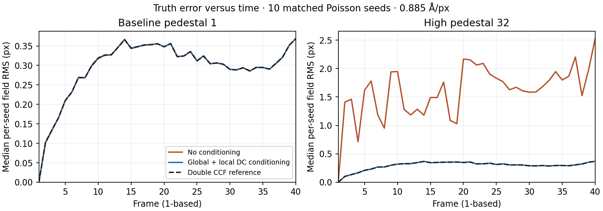

# Motion-truth census (#238 / #262)

**Measured result:** conditioning both global and local CCF DC bins improves
high-pedestal truth accuracy on CPU and CUDA. At pedestal 32, median per-seed
field RMS is **1.78785 → 0.29919 px** on CPU and **1.73835 → 0.29918 px** on
CUDA; each improves 10/10 paired seeds, exact two-sided sign-test **p=0.001953125**.
The double-CCF reference is 0.29919 px. These are 1.58225 → 0.26478 Å and
1.53844 → 0.26478 Å respectively, at 0.885 Å/px.

**Scope:** 100 generated movies, ten fixed conditions × ten independent Poisson
noise seeds, **900/900 native processes exit 0** (500 CPU, 400 A100 CUDA), plus
four high-pedestal stage controls. Release `-O3`, eight pinned CPUs/process,
40 frames, 4096×4096 and 5760×4092, grouping/binning 1. Source and actual binary,
UUID, ingest route, commands, exits and file hashes are retained. No movies are
committed. This is a test-only PR based on #267 `88b34ae0`, targeting
`test/known-motion-diagnostics-v2`; no production repair or merge.

## Accuracy by condition

Rows below use **both** CCF stages conditioned. RMS values are medians of ten
per-seed vector RMS errors in pixels; they are not pooled-pixel statistics.
Neutral/mixed means insufficient directional evidence at the predeclared p<.05,
not equivalence. All p-values are exploratory/unadjusted across the examined
conditions and arms; effect sizes and every regression remain available.

|Condition|CPU none → both RMS px|CUDA none → both RMS px|CPU / CUDA sign p|CPU / CUDA category|
|---|---:|---:|---:|---|
|Dose 0.5|0.42969 → 0.42998|0.43045 → 0.42998|1 / 0.753906|neutral/mixed / neutral/mixed|
|Dose 1|0.29920 → 0.29918|0.29894 → 0.29918|0.753906 / 0.753906|neutral/mixed / neutral/mixed|
|Dose 2|0.19938 → 0.19996|0.19951 → 0.19996|0.753906 / 0.109375|neutral/mixed / neutral/mixed|
|Dose 4|0.13369 → 0.13356|0.13272 → 0.13356|0.34375 / 1|neutral/mixed / neutral/mixed|
|Out-of-model|1.04252 → 1.04241|1.04230 → 1.04241|1 / 0.34375|neutral/mixed / neutral/mixed|
|5760×4092|0.24627 → 0.24611|0.24560 → 0.24611|0.753906 / 1|neutral/mixed / neutral/mixed|
|Pedestal 0|0.29918 → 0.29918|0.29918 → 0.29918|0.34375 / 1|neutral/mixed / neutral/mixed|
|Pedestal 32|1.78785 → 0.29919|1.73835 → 0.29918|0.00195312 / 0.00195312|improves / improves|
|Amplitude ×0.25|0.31416 → 0.29918|0.29715 → 0.29918|0.0214844 / 0.753906|improves / neutral/mixed|
|Amplitude ×4|0.29917 → 0.29918|0.29917 → 0.29918|0.753906 / 1|neutral/mixed / neutral/mixed|

Amplitude ×0.25 shows a smaller, nominal CPU gain (9 wins/1 loss; median paired
Δ −0.01014 px, p=0.0214844); CPU double tracks that gain and CUDA is neutral/mixed. Partial conditioning has
additional small effects: CPU global-only improves at dose4 (Δ −0.000196 px,
p=0.0019531) and nonsquare (Δ −0.000359 px, p=0.0214844). CUDA global-only
nominally **harms** out-of-model accuracy by **+0.00002664 px** (1 win/9 losses,
p=0.0214844). This tiny regression is retained, not rounded into an improvement.
All other float-arm total-field comparisons are neutral/mixed except the high-pedestal
improvements, including the CPU double reference there.

At pedestal32, CPU global-only/local-only/both median RMS is
0.89346/1.30120/0.29919 px; CUDA is 0.89346/1.18460/0.29918 px. CPU global-only,
CPU local-only and CUDA global-only improve 10/10 seeds (p=0.0019531); CUDA
local-only improves 8/10 (p=0.109375, neutral/mixed). Global nonconvergence is
10/10 with neither or local-only on each backend, 0/10 with global-only/both
or CPU double. Local models are disabled 10/10 with neither/global-only, 0/10
with local-only/both/double. Other conditions have no global nonconvergence or
local-model disablement. These states remain distinct from process success.

## Numerical reference and remaining accuracy limits

Both conditioned float backends reach the declared ≤0.001 px numerical-reference
proximity in **100/100 movies**. Worst lattice field distance to CPU double is
**1.5828e−5 px (CPU)** and **1.5315e−4 px (CUDA)**. The reference retains float
movie spectra, weights and shift feedback; it is not a fully double movie
pipeline or motion truth. Double none/both final field neutrality on the
high-pedestal control is 1.3126e−5 px, not bit equality.

CPU/CUDA continuity by DC arm, over the 100 movies (median per-movie field RMS
/ worst field maximum distance, px): none **0.0035609 / 6.03692**;
global **0.0020177 / 0.169616**; local **0.0027174 / 5.68562**;
both **1.7348e−6 / 1.5916e−4**. These measure model agreement, not accuracy or
published-image equality.

The remaining truth error is material: pedestal32 both/double still fail the
unchanged 0.20/0.40/0.80 Å RMS/P95/max field-distance limits in **9/10 seeds**.
At both-conditioned dose2, 3/10 fail; dose4, 0/10 fail. The out-of-model reference
has median RMS **1.04241 px**, and all ten seeds fail. These new-family limits
are descriptive characterization, not an overall scientific PASS.

These runs are non-dose-weighted. Native STAR dose-rate metadata stays at its
unused default; fixture receipts give the actual generated e/px/frame.

Global/local errors use the declared recipe decomposition and can compensate;
total field error is primary. Primary metrics evaluate the admitted pre-write
native model, not a fit rebuilt
from rounded STAR observations. Serialization field loss reaches **0.0122075 px**
and is reported separately. Actual production resampling arithmetic/published
pixel consistency and residual frequency transfer are **UNRUN** here. No
CTF/FSC/downstream science or controlled performance claim is made.

The high-pedestal stage control measures CCF peak values around 39,936 and
float32 spacing 0.00390625; its independent double five-sample neighborhood
spread is about 0.005 CCF units. Neighborhoods are at each selected peak,
not full-map contrast or a same-sample curvature proof. This is a deliberately
weak-texture counting proxy without CTF, radiation damage, detector MTF or event
coincidence. Ten noise seeds share one generated scene per geometry; the
population does not establish general accuracy on experimental micrographs.

**Recommendation for #262:** the truth and numerical evidence supports conditioning
both CCF stages, independently of legacy CPU agreement. Keep the shared bug
FILE-ONLY in production under the current policy; use this evidence for the
maintainer decision and subsequent held-out scientific/performance qualification.
Do not close the remaining low-SNR/model-quality work or infer release readiness.

## Native #267 controls on main

All eight 128×96×5 cases completed on CPU and CUDA at main `36913740`, with
fixture/checker `88b34ae0`. Zero passes; integer/fractional/affine/pedestal fail
the original field gate on both. Noisy fails the field-distance criteria, with
the original CPU checker aborting before a verdict. Flat/repeated are
unidentifiable characterization scenes. The original checker also aborts on
both repeated estimates because finite candidate coordinates leave the fixed ROI.

Per-case px/Å RMS/P95/max and global convergence: [table](native_v2_table.md),
[JSON](native_v2_metrics.json). Original checker errors and independent field-only
distances are kept distinct. No ROI or tolerance was relaxed. The native
checker/adapter problem was reported in a short
[#267 comment](https://github.com/KingAlejandro/MotionCorr-standalone/pull/267#issuecomment-6314920945).
Historical `km_local_noisy` accuracy FAIL remains characterization in
`docs/known_motion_validation.md`; it is not superseded by an OVERALL PASS.

Native 512×384×5 noiseless controls recover zero exactly. Direct MRC and
row-correct TIFF produce identical translation trajectories: RMS 0.0573613 px,
P95/max 0.0960452 px. The wrong-row TIFF mutant reaches RMS 9.85013 px, max
16.0885 px. MRC synthesis uses native rows directly. No generic re-encode is
used as an unverified truth adapter.

## Evidence and reproduction

- [Interactive report](report.html), [per-arm px/Å statistics](accuracy_per_arm.csv),
  [all 900 seed rows](accuracy_per_seed.csv), [paired seed statistics](paired_seed_statistics.csv).
- [Global/local/total errors versus time](time_errors.csv), [CPU/CUDA agreement](backend_agreement.csv),
  [float/double distances](double_reference_distance.csv), [compressed complete summary](SUMMARY.json.gz).
- [Protocol and boundaries](DESIGN.md), [independent mapping bounds](mapping-bounds.json),
  [100 fixture receipts/hashes index](FIXTURE_INDEX.json), [native validation](VALIDATION.json).
- [Source/overlay provenance](source-provenance.json), [CPU](cpu64-provenance.txt),
  [CUDA/UUID](4gpus-provenance.txt), [stage control](stage-control-summary.json).
- [Raw records](raw.tar.gz), [every raw file SHA256](raw.sha256),
  [archive verification](archive-verification.json). Native EPS/PDF renderings are
  omitted from this archive with [hashes retained](rendered-products.sha256);
  complete source archives remain on the hosts. The earlier
  [v2 raw archive](native_v2_raw.tar.gz) has its own [index](native_v2_raw_index.json).



Requirements: NumPy; SciPy for independent oversampled synthesis; Matplotlib for
this figure. No external movie downloads or simulator code are required. NumPy
and SciPy use GPL-2.0-or-later-compatible BSD licenses. Numerical source remains
`97fd81070566af0358ccc839b6804a99b6bf52c1` (#254+#260), with the retained
`capture_runtime_model.patch` observation overlay throughout. The later diagnostic
head `afba50a4` differs only in its observation hook. No production C++ file is
changed by this PR. The native hook on/off control preserves MRC core header,
payload and STAR exactly; timestamp labels are excluded.

```sh
OPENBLAS_NUM_THREADS=1 python3 tools/test_realistic_motion.py -v
python3 test-data/generate_realistic_motion.py --condition dose1 \
  --expectation /scratch/inmodel.npy --make-expectation
python3 test-data/generate_realistic_motion.py --condition dose1 --seed 0 \
  --expectation /scratch/inmodel.npy --outdir /scratch/fixtures/dose1-s00
python3 tools/run_realistic_motion_census.py --root /scratch \
  --binary /absolute/pinned-diagnostic-build/motioncorr --backend cpu --cpus 0-7
python3 docs/post_rc0/s1/km_truth/evaluate_final.py /scratch
python3 tools/summarize_realistic_motion.py --root /scratch \
  --json docs/post_rc0/s1/km_truth/SUMMARY.json.gz
```

Generate all ten declared conditions/seeds and merge their completed CPU/CUDA
records before final evaluation; the evaluator refuses fewer than 900 records.
Host scripts retain exact orchestration, including the pedestal prefetch order.
Movies remain on 4GPUs in `/mnt/clathrin/alex-motioncorr-km-truth/fixtures/`;
all CPU sums are retained in verified archives under `retained-cpu-products/`.
Only verified duplicates were released from cpu64. No advisory GPU lock was deleted;
at most one was held, and it was released between seed batches. Native workers
have finished.

Metrics schema 2 uses explicit native CUDA convergence verdicts; CPU exact-0.5
rounded logs are ambiguous rather than passes. All 900 records are classified,
with no ambiguity. The 275 interim schema-1 records are preserved separately;
field statistics agree within 1e−10 px. No historical acceptance baseline was rewritten.

Validation: **10** new infrastructure tests, **24** existing diagnostic/verdict/
runner controls pass locally. Linux CI at code head `4916ec04`
[run 39599320952](https://github.com/KingAlejandro/MotionCorr-standalone/actions/runs/39599320952)
passes. Native execution is established separately by all process receipts and
400 explicit CUDA global-completion witnesses. The interactive artifact checks
all 20 condition/unit views; archive contents are individually read back and hashed.
